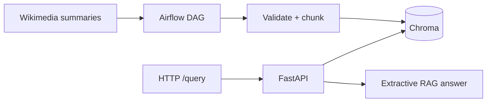

# airflow-chroma-rag

An Airflow DAG in Docker that **ingests a public dataset**, **validates** it, **loads Chroma**, and serves a **simple RAG query**. Built so you can point to a repo instead of a reading list.

Skills this demonstrates: **Apache Airflow**, **Docker Compose**, **Chroma**, **Python** (ingest/validate/chunk/API), and **pytest**.

## Architecture



Three services:

| Service | Port | Role |
| --- | --- | --- |
| `airflow` | 8080 | SequentialExecutor webserver + scheduler |
| `chroma` | 8000 | Vector store (embeds on the server) |
| `rag-api` | 8001 | `/health` and `/query` |

The DAG is a full-refresh load of a small corpus. Re-runs replace the collection instead of duplicating chunks.

## Dataset

Live ingest uses the [Wikimedia REST summary API](https://en.wikipedia.org/api/rest_v1/) (no API key) for a fixed list of data-engineering topics: Airflow, Docker, vector databases, RAG, embeddings, ETL, data pipelines, and Python.

If Wikipedia is unreachable, the DAG falls back to a bundled fixture in `src/airflow_chroma_rag/data/sample_docs.json`. Tests always use fixtures / mocked HTTP so they do not need the network.

## Quick start

Prerequisites: Docker with the **Compose plugin** (`docker compose version`), and Python 3.9+ for local tests (images use 3.11).

```bash
docker compose up --build
```

First boot pulls Airflow and Chroma images and can take several minutes. Airflow UI: [http://localhost:8080](http://localhost:8080) — `admin` / `admin`.

### Trigger the DAG

UI: enable `rag_ingest_pipeline` if needed, then Trigger DAG.

CLI:

```bash
docker compose exec airflow airflow dags unpause rag_ingest_pipeline
docker compose exec airflow airflow dags trigger rag_ingest_pipeline
```

Tasks: `ingest_public_dataset` → `validate_records` → `chunk_documents` → `load_chroma`.

### Ask a question

```bash
curl -s http://localhost:8001/query \
  -H 'content-type: application/json' \
  -d '{"question":"What is Apache Airflow used for?","top_k":4}'
```

Default mode is **extractive RAG**: retrieved chunks concatenated with sources. If `OPENAI_API_KEY` is set, the API optionally writes a short grounded answer. The stack runs with **no paid keys**.

## Tests

```bash
python3 -m venv .venv
source .venv/bin/activate
pip install -r requirements-dev.txt
PYTHONPATH=src python -m pytest
```

Coverage: validation, chunking, ingest + fixture fallback, Chroma full-refresh + query, DAG task wiring.

## Project layout

```
dags/rag_ingest_dag.py          # Airflow wiring (XCom between tasks)
src/airflow_chroma_rag/         # ingest, validate, chunk, Chroma, RAG
api/main.py                     # FastAPI
tests/                          # pytest, no live Airflow required
Dockerfile.airflow
Dockerfile.api
docker-compose.yml
```

## Limitations

- SequentialExecutor + SQLite is for a laptop demo, not a production Airflow cluster.
- The corpus is small on purpose so embeddings stay fast.
- Chroma’s default embedding model is downloaded on first use inside the Chroma container.
- Generative answers are optional and off unless you provide an OpenAI key.

## License

MIT
